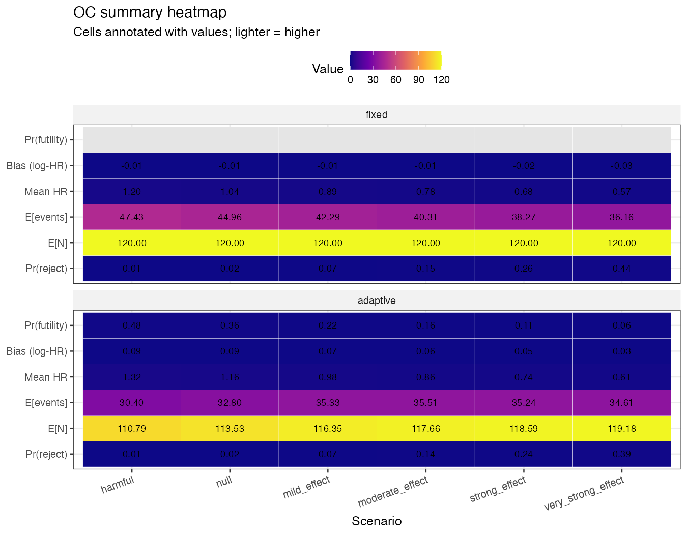

# Bayesian Adaptive Phase II Oncology Trial Simulator

> Simulator for a Phase II oncology trial with a time-to-event primary endpoint. It compares a Bayesian adaptive design (one event-driven interim with a futility stop, then response-adaptive randomization) against a fixed 1:1 design, and runs a parallel survival analysis on TCGA-BRCA. Built in R and Stan, with a Quarto report, a mock SAP section in ICH E9(R1) estimand language, and SAS programs for cross-checking the design and survival analyses.



**📄 Read the report:**
- **[Rendered report (HTML)](https://kbd0011.github.io/bayesian-adaptive-trial-sim/)** - full main report, served via GitHub Pages
- **[Mock SAP section (HTML)](https://kbd0011.github.io/bayesian-adaptive-trial-sim/sap_section.html)**
- Source: [`report/index.qmd`](report/index.qmd) (main), [`report/sap_section.qmd`](report/sap_section.qmd) (mock SAP)

## Headline result

> 12,000 simulated trials (1,000 per scenario × 6 scenarios × 2 designs). The Bayesian adaptive design's estimated Type I error is **0.019** (95% CI 0.011–0.030) against a one-sided target of 0.025, versus 0.021 (0.013–0.032) for the fixed design. It stopped early for futility in **48% of trials under a harmful effect (HR 1.15)** and **36% under the null**, cutting expected sample size by 5–8% in those scenarios. Power was similar at HR 0.85 (0.075 adaptive vs 0.069 fixed), and the adaptive design gave up 0.7–5.6 percentage points of power at HR 0.75–0.55: the standard adaptive-design trade of some peak power for fewer patients enrolled when the therapy does not work.

## What this demonstrates

- **Adaptive trial design** with an event-driven interim (fires when 12 events accumulate, 30% of the events expected under the design alternative HR = 0.70), a Bayesian futility rule (stop if P(HR < 0.7 | data) < 0.20), and post-interim Thompson-style response-adaptive randomization (sqrt damping + 20/80 caps, refit every 20 enrollees).
- **Like-for-like comparison with a fixed design.** The fixed design randomizes 1:1 and has a single final analysis. Both designs test the final Cox z-statistic against the same final-stage efficacy boundary (z = 1.960), taken from a two-stage `{rpact}` O'Brien-Fleming design (alpha + beta spending).
- **Bayesian exponential survival** at the interim, fit in Stan with a baseline-rate-centered Gamma prior on the control hazard. Compiled once, cached on disk, parallelized across `furrr` workers.
- **Parallel survival analytics** on n = 1,002 TCGA-BRCA patients: Kaplan-Meier (with log-rank + risk table), Cox PH with a Schoenfeld diagnostic and a stratified sensitivity fit, and a Bayesian Weibull AFT with a posterior-predictive KM overlay.
- **Two survival models, one conclusion.** Semi-parametric Cox PH and a parametric Bayesian Weibull AFT agree that hormone-receptor-positive status is protective and that each decade of age raises the hazard.
- **Mock SAP section** in ICH E9(R1) estimand language, with ITT / mITT / safety analysis populations and a futility-threshold sensitivity sweep.
- **Reproducibility as code**: `Makefile`, `config.yml`, seeded RNG, an `renv` lockfile, and two GitHub Actions workflows. CI runs a reduced 100-sim version of the pipeline, the full TCGA analysis, the unit tests and the Quarto render on each push to `main`; the publish workflow runs the full simulation in 10 shards and deploys the HTML report to GitHub Pages.

## Stack

R 4.3 · Stan / `{rstan}` · `{rpact}` · `{survival}` · `{survminer}` · `{furrr}` · `{bayesplot}` · `{posterior}` · `{flextable}` · Quarto · SAS (PROC SEQDESIGN / LIFETEST / PHREG programs)

## Repository structure

```
config.yml             all simulation + design parameters (no hard-coded numbers in code)
Makefile               make sims | tcga | report | test | all
R/
  00_setup.R           libs, paths, future multisession, helpers
  01_design_params.R   rpact two-stage OBF design + interim event target
  02_sim_fixed.R       fixed-design simulator (1:1, one final analysis, Cox z vs final OBF boundary)
  03_sim_adaptive.R    adaptive simulator with event-driven Bayesian interim + RAR
  04_run_all_sims.R    furrr orchestrator (--n-sims, --workers, --shard-id CLI flags)
  05_oc_compute.R      operating-characteristics aggregator (with MCSE)
  06_oc_plots.R        4 OC figures (power, E[N], futility, summary heatmap)
  07_tcga_data.R       TCGA-BRCA pull + clean (RTCGA::survivalTCGA)
  08_tcga_km.R         Kaplan-Meier by hormone-receptor status
  09_tcga_cox.R        Cox PH + Schoenfeld + stratified sensitivity
  10_tcga_bayes_aft.R  Bayesian Weibull AFT in Stan + PP KM overlay
  11_futility_sensitivity.R  futility-threshold sweep for the SAP sensitivity
stan/
  exp_survival.stan    interim Bayesian model (adaptive design)
  weibull_aft.stan     Weibull AFT model (TCGA case study)
sas/
  seqdesign.sas        PROC SEQDESIGN program for the design boundaries
  tcga_lifetest.sas    PROC LIFETEST program mirroring R/08 (KM + log-rank)
  tcga_phreg.sas       PROC PHREG program mirroring R/09 (Cox + PH assessment)
report/
  index.qmd            full Quarto report (11 sections, 10 figures)
  sap_section.qmd      standalone mock SAP, ICH E9(R1) estimand structure
tests/                 testthat unit tests, run via per-file Rscript subprocesses
.github/workflows/
  ci.yml               reduced pipeline + tests + report render on each push to main
  publish.yml          sharded full simulation + render + deploy to GitHub Pages
outputs/               figures (PDF + PNG) and tables (CSV)
```

## Reproducing

First-time setup (restores all R + Stan package versions pinned in `renv.lock`):

```r
# from R, in the project directory
renv::restore()
```

> **macOS note.** R's "recommended" packages (`Matrix`, `MASS`, `survival`, etc.) ship with R itself rather than being installable from CRAN. `renv::restore()` on macOS sometimes errors with `package 'Matrix' is not available` if a CRAN/PPM mirror doesn't list them separately. The renv settings in this project (`renv/settings.json` → `external.libraries` and `ignored.packages`) tell renv to source these from your R installation. If you still hit the issue, install R 4.3.1 from CRAN (`pkg.r-project.org`) first - it bundles all the recommended packages - then re-run `renv::restore()`. CI on Linux uses Posit Package Manager and doesn't see this issue.

Then:

```bash
make sims         # 12,000 trial simulations (4 furrr workers by default)
make tcga         # TCGA KM + Cox + Bayesian AFT pipeline (writes sas/data/tcga_brca.csv too)
make sas-data     # just the CSV export, for SAS-only users
make sensitivity  # futility-threshold sweep used in SAP §10.5
make report       # render Quarto report and SAP section
make test         # testthat suite (per-file subprocess isolation)
make all          # sims + tcga + report (sensitivity not included by default)
make clean        # remove all generated outputs
```

All randomness is seeded from `CONFIG$simulation$seed = 20260513` with per-sim seeds derived as `seed + sim_id * 10 + as.integer(factor(design))`. Stan models compile once and cache to `stan/*.rds` (gitignored). Package versions are pinned via `renv` (R 4.3.1, lockfile in `renv.lock`).

**Output policy.** PNG figures (used by this README) and CSV tables are committed. PDF figures (used only by the rendered Quarto report) and the SAS-input CSV (regenerated by `R/07`) are gitignored to keep the working tree clean across re-runs. `make all` regenerates the PDFs and the SAS CSV.

## Operating-characteristics summary

| Scenario | Design | True HR | Reject rate | 95% CI | P(futility) | E[N] | E[events] | Mean HR |
|----------|--------|---------|-------------|--------|-------------|------|-----------|---------|
| null            | adaptive | 1.00 | 0.019 | (0.011, 0.030) | 0.36 | 113.5 | 32.8 | 1.16 |
| null            | fixed    | 1.00 | 0.021 | (0.013, 0.032) | -    | 120.0 | 45.0 | 1.04 |
| harmful         | adaptive | 1.15 | 0.008 | (0.003, 0.016) | 0.48 | 110.8 | 30.4 | 1.32 |
| harmful         | fixed    | 1.15 | 0.010 | (0.005, 0.018) | -    | 120.0 | 47.4 | 1.20 |
| mild            | adaptive | 0.85 | 0.075 | (0.059, 0.093) | 0.22 | 116.3 | 35.3 | 0.98 |
| mild            | fixed    | 0.85 | 0.069 | (0.054, 0.087) | -    | 120.0 | 42.3 | 0.89 |
| moderate        | adaptive | 0.75 | 0.139 | (0.118, 0.162) | 0.16 | 117.7 | 35.5 | 0.86 |
| moderate        | fixed    | 0.75 | 0.146 | (0.125, 0.169) | -    | 120.0 | 40.3 | 0.78 |
| strong          | adaptive | 0.65 | 0.238 | (0.212, 0.266) | 0.11 | 118.6 | 35.2 | 0.74 |
| strong          | fixed    | 0.65 | 0.263 | (0.236, 0.291) | -    | 120.0 | 38.3 | 0.68 |
| very_strong     | adaptive | 0.55 | 0.387 | (0.357, 0.418) | 0.06 | 119.2 | 34.6 | 0.61 |
| very_strong     | fixed    | 0.55 | 0.443 | (0.412, 0.474) | -    | 120.0 | 36.2 | 0.57 |

Full table: `outputs/tables/oc_table.csv`. Plots: `outputs/figures/oc_*.{pdf,png}`.

## TCGA-BRCA case study (n = 1,002, 97 events)

| Term | Cox PH: HR (95% CI) | Bayesian Weibull AFT: time ratio (95% CrI) |
|---|---|---|
| HR+ vs HR- | 0.555 (0.36, 0.86) | 1.40 (1.07, 1.87) |
| Age (per decade) | 1.28 (1.10, 1.49) | 0.85 (0.78, 0.94) |

Sources: `outputs/tables/tcga_cox_results.csv` and `outputs/tables/tcga_bayes_aft_summary.csv` (posterior medians). A time ratio above 1 means longer survival.

Both models find HR+ status significantly protective and each decade of age significantly risk-increasing; no interval includes the no-effect value, and the Kaplan-Meier log-rank test separates the receptor groups (p = 0.030). A Weibull model with a single shape parameter is also a proportional-hazards model, with hazard ratio TR^(−shape). Converted with the fitted shape (1.60, 95% CrI 1.41–1.81), the AFT effects land close to the Cox hazard ratios. So the comparison shows the effects do not depend on leaving the baseline hazard unspecified (Cox) versus modelling it as Weibull. It is not a check of proportional hazards: that is the Schoenfeld test, which flags receptor status, and `R/09` adds a Cox model stratified on receptor status as the sensitivity fit. Bayes diagnostics: max R̂ = 1.003, min bulk ESS = 1,598, 4 chains × 2,000 iterations.

## Scope and limitations

- **Phase II screening design.** Maximum n = 120 with 24-month follow-up is deliberately small for a Phase II go/no-go trial; rpact's sample-size calculator says n ≈ 791 would be needed for 80% power at HR = 0.70 with this alpha-spending. Power at smaller effect sizes (HR 0.75 / 0.85) is correspondingly modest. This is by design, not a misconfiguration.
- **Simulation precision.** With 1,000 runs per scenario, the 95% CI on the adaptive Type I error (0.011–0.030) still includes the 0.025 target. A larger null-scenario run would narrow it.
- **Interim timing chosen at 30% information under H1.** A 50% interim was originally specified but, at this n and event-rate envelope, almost never accumulated the target event count before end-of-study; 30% places the interim inside the practical event-accrual window. Sensitivity analysis across alternative information fractions is on the roadmap.
- **Futility threshold (P(HR < 0.7 | data) < 0.20) is operator-defined.** `R/11_futility_sensitivity.R` sweeps it over 0.10, 0.15, 0.20 and 0.30 (300 runs per cell, `outputs/tables/futility_sensitivity.csv`): futility stops rise with the threshold while power moves by less than the simulation error. Details in SAP §10.5.
- **Adaptive HR estimates are biased upward** (mean log-HR bias +0.03 to +0.09, decreasing with stronger true effect) due to two mechanisms: (1) futility-stopped trials report the interim Bayesian posterior median, which is pulled toward HR = 1 by the weakly informative prior; (2) RAR-induced allocation imbalance modestly inflates the Cox HR estimate under benefit. The fixed design's bias is the standard small-sample Cox attenuation (-0.01 to -0.03), opposite direction. Quantified in `report/index.qmd` §7 (bias table by scenario × design); see `outputs/tables/oc_table.csv` `bias_log_hr` column. The Cox PH analysis does not adjust for RAR-induced imbalance - an IPTW-weighted sensitivity would be the standard regulatory companion.
- **TCGA-BRCA tests the survival toolkit, not the data-generating model.** The endpoint (overall survival in breast cancer) differs from the simulator's (time-to-progression in a hypothetical oncology indication). The TCGA section demonstrates that the same Stan / KM / Cox / AFT pipeline works on real, messier data - not that the simulator's exponential data-generating model matches breast cancer biology.
- **SAS programs are provided for cross-checking, without committed output.** `sas/seqdesign.sas` still specifies the original 50% interim, so it needs `info=cum(0.3 1.0)` before its boundaries can be compared with `outputs/tables/design_boundaries.csv`.


## Background

- ICH E9(R1) - *Statistical Principles for Clinical Trials, Addendum on Estimands*, 2019.
- FDA - *Adaptive Designs for Clinical Trials of Drugs and Biologics*, 2019.
- O'Brien PC, Fleming TR (1979) - *A multiple testing procedure for clinical trials.* Biometrics 35: 549–556.
- Cox DR (1972) - *Regression models and life-tables.* J R Stat Soc B 34: 187–220.
- Wassmer G, Brannath W (2016) - *Group Sequential and Confirmatory Adaptive Designs in Clinical Trials.* Springer.
